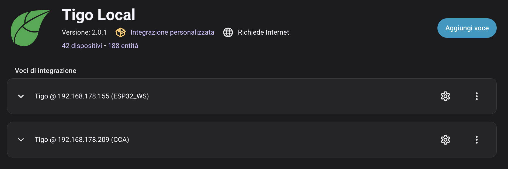
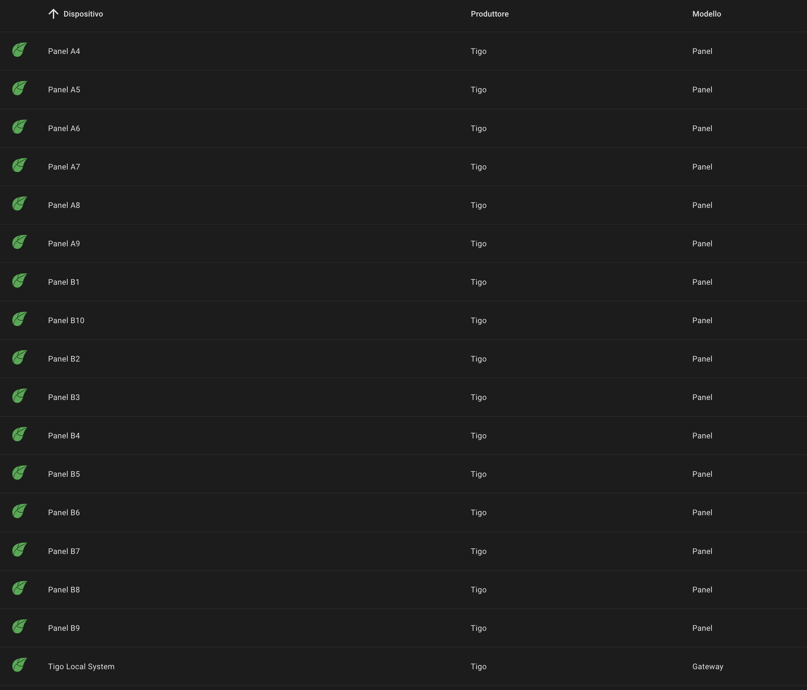
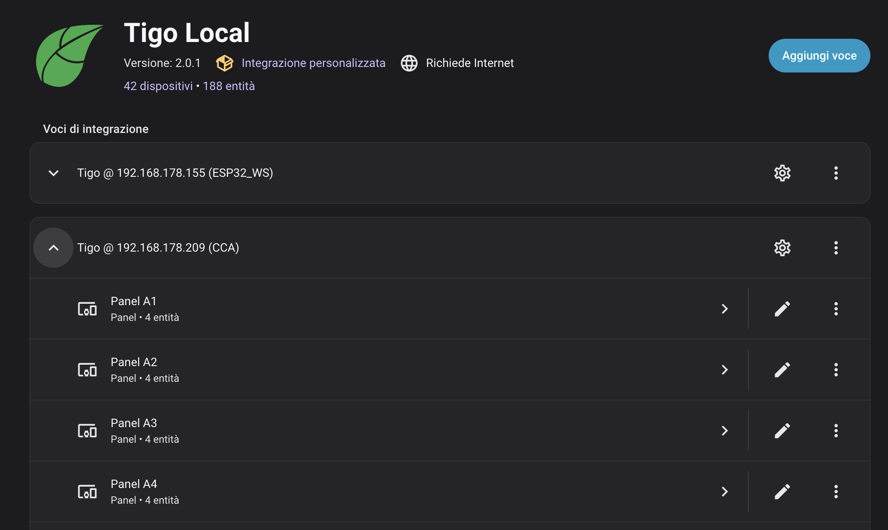
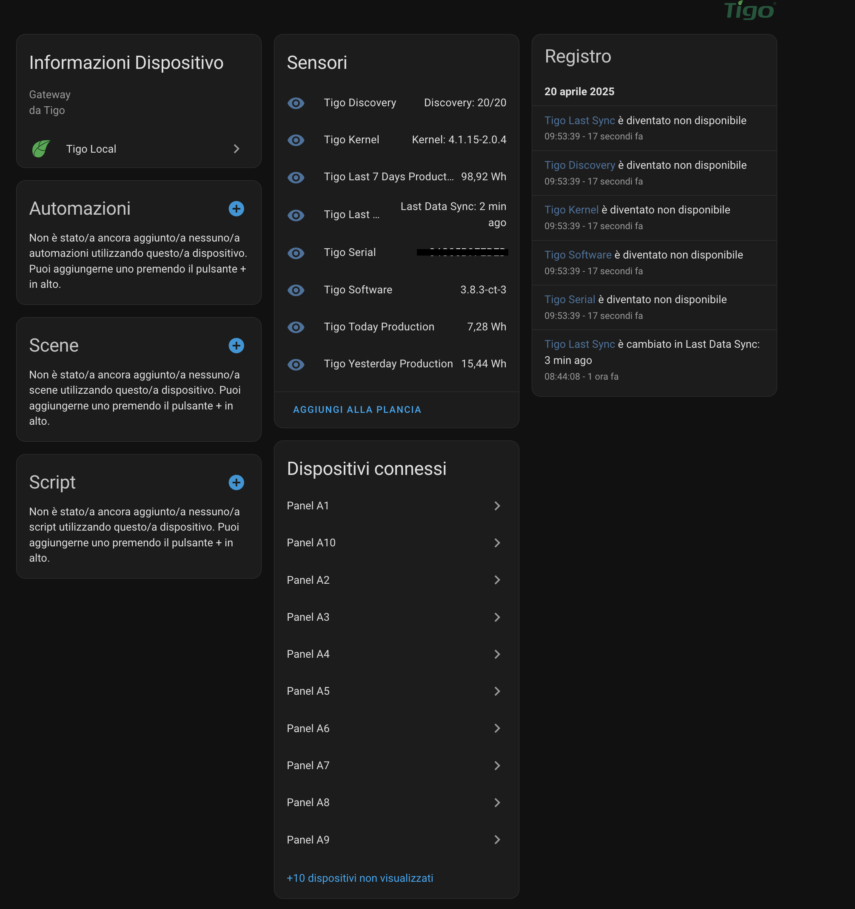

[](https://ko-fi.com/silviosmart)

## Supportami / Support Me

Se ti piace il mio lavoro e vuoi che continui nello sviluppo delle card, puoi offrirmi un caffè.\
If you like my work and want me to continue developing the cards, you can buy me a coffee.

[](https://www.paypal.com/donate/?hosted_button_id=Z6KY9V6BBZ4BN)

Non dimenticare di seguirmi sui social:\
Don't forget to follow me on social media:

[](https://www.tiktok.com/@silviosmartalexa)

[](https://www.instagram.com/silviosmartalexa)

[](https://www.youtube.com/@silviosmartalexa)

# Tigo Energy Integration for Home Assistant (Local + Cloud)

A custom integration that connects Home Assistant to a **Tigo CCA** (Cloud Connect Advanced) or **ESP32-based Tigo panels** via the local network, or to your **Tigo cloud account**. It fetches per-panel and system solar data.

> [!IMPORTANT]
> **Since v4.0.0 this integration replaces [tigosolar-online](https://github.com/Bobsilvio/tigosolar-online)**,
> which is now archived. Its cloud engine (Tigo API v4 + v3 fallback, Premium support, backoff,
> outage Repair, Energy Dashboard counter) is now the **Cloud source** of this integration.
> Coming from tigosolar-online? See [Migrating from tigosolar-online](#migrating-from-tigosolar-online) —
> your entities and history are kept.

 


---

## NOTE -  IF STOP WORKING??

If the integration stops working and you can’t see any data from Tigo, you may need to update the CCA.
Open the Tigo app on your phone and move as close as possible to the CCA to establish a Bluetooth connection. Then update the CCA firmware.
Once it reboots, the integration should start working again.

> [!IMPORTANT]
> If your CCA firmware is **>= 4.0.4**, the local endpoints are password-locked and local data is no
> longer accessible. In that case use the **Cloud source** — see [Cloud source](#cloud-source) below.

## HACS

This integration can be installed manually or via HACS when available.

[](https://my.home-assistant.io/redirect/hacs_repository/?owner=bobsilvio&repository=tigosolar-local&category=integration)

## MANUAL INSTALLATION

1. Copy the `tigo` directory into `/config/custom_components/`.

2. Restart Home Assistant.

3. Go to **Settings → Devices & Services → Add Integration**, and search for **Tigo Energy**.

4. Choose the source:
   - **CCA** / **ESP32_WS**: enter the **local IP address** (e.g., `192.168.1.100`). On CCA firmware
     **>= 4.0.4** the setup then asks for your **Tigo account email and password** and uses the
     [Cloud source](#cloud-source).
   - **CLOUD**: no IP needed, just your Tigo account (same credentials as the Tigo app).

> [!IMPORTANT]
> Do **not** include `http://` or use hostnames like `tigo.local`.

---

## 📦 Features

- Connects locally to your Tigo CCA or ESP32-based panels via IP.
- Retrieves data for **each individual panel**, including:
  - Power (W)
  - Voltage (V)
  - Current (A)
  - Temperature (°C) *(for ESP32 panels)*
  - Signal Strength (dBm)
- Organizes panels by inverter and string (CCA) or just panels (ESP32).
- **Panel display name** read live from the ESP32 firmware `panel` field (e.g. `A1`, `B6`). If the name is assigned later, the sensor title updates automatically on the next poll — no history is lost.
- **Energy sensors per panel** (Day and Month) with automatic reset at midnight / start of month and correct `last_reset` signaling to the Home Assistant Energy dashboard.
- Displays **daily and 7-day energy history** (if available, for CCA).
- No credentials required, works entirely over local HTTP access.
- Updates every 30 seconds by default (configurable).

---

## 🔗 Supported Sources

- **CCA** – Tigo Cloud Connect Advanced (local)
- **ESP32** – ESP32-based Tigo panel monitoring firmware ([project link](https://github.com/Bobsilvio/tigo_server))
- **Cloud** – Tigo account (`mapi.tigoenergy.com`, legacy `api2.tigoenergy.com` as fallback), for CCA firmware >= 4.0.4 (local endpoints password-locked) or when you have no local access

---

## Cloud source

Newer CCA firmware (**>= 4.0.4**) password-locks the local `/cgi-bin` endpoints, so local data
becomes unreachable. The Cloud source reads the same data the official Tigo app shows.

During setup either pick **CLOUD** directly, or enter the local IP: the integration **detects the
firmware** and, if local data is locked, asks for your **Tigo account** and switches to the cloud.
If it doesn't switch automatically, tick **"Force cloud"** in the first step.

The cloud engine comes from [tigosolar-online](https://github.com/Bobsilvio/tigosolar-online)
(v2, by [@TerryFrench](https://github.com/TerryFrench)):

- **API selection**: `auto` (v4, fall back to v3), `v4` or `v3` — at setup and in **Options**.
- **Token lifecycle**: token persisted across restarts, transparent re-login, **re-authentication** flow.
- **Premium**: with a Tigo EI **Premium** subscription you also get per-panel **Voltage**, **Current**
  and **Signal Strength** (disabled by default: enable the entities, or the toggles in Options).
- **Resilience**: exponential backoff, strict respect of throttling (`429`/`503` + `Retry-After`),
  a **Tigo API** connectivity `binary_sensor` and a **Repair** issue during prolonged outages.
- **Efficient polling**: incremental per-minute fetch, night skip, CCA-cadence skip.
- **Energy Dashboard**: `sensor.…_production` is a monotonic lifetime counter (`total_increasing`)
  that survives restarts — add it under *Settings → Energy → Solar production*.
- **Diagnostics**: *Settings → Devices & Services → Tigo → ⋯ → Download diagnostics* (secrets redacted).

| Sensor | Basic account | Premium |
|---|---|---|
| System: Current Power, Production Today, Production (lifetime) | ✅ | ✅ |
| Panel: Power, Energy (lifetime) | ✅ | ✅ |
| Panel: Reclaimed Power | ✅ (disabled by default) | ✅ |
| Panel: Voltage, Current, Signal Strength | ❌ | ✅ (disabled by default) |

> [!WARNING]
> Cloud data is **not real-time**. The CCA uploads to the cloud every ~10–15 min and panels report
> sporadically, so values can lag by several minutes. Polling faster does **not** give fresher data.

### Migrating from tigosolar-online

Both integrations use the same `tigo` folder, so **don't delete the Tigo integration** in
*Settings → Devices & Services*: just swap the files and restart.

1. **HACS → Tigo Energy (tigosolar-online) → ⋮ → Remove**.
2. **HACS → ⋮ → Custom repositories** → add `https://github.com/Bobsilvio/tigosolar-local` (Integration),
   then download **Tigo Energy** from it (or use the button in [HACS](#hacs)).
3. **Restart Home Assistant.**

The existing entry is migrated automatically to the Cloud source: same entities, same unique IDs,
history and Energy Dashboard kept. Options (Premium, API version, intervals) are kept too.

### Upgrading from tigosolar-local ≤ 3.1.x with the Cloud source

The old Cloud source is replaced by the new engine and migrated automatically on restart:

- **kept** (same entity, history preserved): system *Power*, *Today Production*, *Lifetime Production*
  (now the monotonic Energy Dashboard counter), panel *Power* and *Reclaimed Power*;
- **removed** (no equivalent in the new engine): *Power Peak Today*, *Week/Month/Year Production*,
  *Reclaimed Today*, panel *Energy Today* — replaced by the per-panel lifetime *Energy* counter.

CCA and ESP32 local sources are unchanged.

---

## 📄 Sensor Naming Convention

The `entity_id` is generated automatically by Home Assistant from the **entity name**, which follows this pattern:

```
Panel <label> <parameter>
```

- `<label>` → for **CCA**: the panel label from the layout (e.g. `A2`, `B1`); for **ESP32**: the `panel` field from the WebSocket (e.g. `A1`, `B6`), or the `addr` if no name is assigned yet (e.g. `001B`)
- `<parameter>` → `Power`, `Voltage`, `Current`, `Temperature`, `Signal Strength`, `Energy`, `Energy Day`, `Energy Month`

The **unique_id** (internal, never changes) is based on source + IP + `addr`/panel_id, so renaming a panel on the ESP32 later updates only the display name — **no new entity is created, history is preserved**.

**Examples:**

- CCA Panel A2 Current:  
  `sensor.panel_a2_current`

- ESP32 Panel with addr `001B` (no name assigned yet):  
  `sensor.panel_001b_current`

- ESP32 Panel A1 (name assigned, addr `001B`):  
  `sensor.panel_a1_current`

- ESP32 Panel A1 Energy Day:  
  `sensor.panel_a1_energy_day`

- ESP32 Panel A1 Energy Month:  
  `sensor.panel_a1_energy_month`

---

## 📸 Example Entities

### CCA Panels
- `sensor.panel_b1_power` → Panel B1 Power
- `sensor.panel_b2_voltage` → Panel B2 Voltage
- `sensor.panel_a2_current` → Panel A2 Current
- `sensor.tigo_today_production` → Tigo Today Production
- `sensor.tigo_last_7_days_production` → Tigo Last 7 Days Production

### ESP32 Panels
- `sensor.panel_a1_power` → Panel A1 Power
- `sensor.panel_a1_voltage` → Panel A1 Voltage
- `sensor.panel_a1_current` → Panel A1 Current
- `sensor.panel_a1_temperature` → Panel A1 Temperature
- `sensor.panel_a1_energy` → Panel A1 Energy (cumulative, TOTAL_INCREASING)
- `sensor.panel_a1_energy_day` → Panel A1 Energy Day (resets at midnight)
- `sensor.panel_a1_energy_month` → Panel A1 Energy Month (resets on 1st)

> **Note:** if the panel has no name yet, `A1` is replaced by the `addr` value, e.g. `sensor.panel_001b_power`.

---

## ⚠️ Important Notes

- After updating to v2.0.0:
  - You **must recreate the integration** in Home Assistant.
  - Existing automations referencing old sensor names need to be **updated to the new naming convention**.
- ESP32 panels are supported via [this project](https://github.com/Bobsilvio/tigo_server). Only panel-level sensors are available (no CCA gateway/system info).
- CCA sensors will continue to provide inverter, string, and module information.

---

## 🙏 Credits

This project is inspired by reverse-engineering efforts and aims to bring **offline, privacy-friendly** monitoring of Tigo solar installations to Home Assistant.

---

## 📄 License

This project is licensed under the [MIT License](LICENSE).
